# HƯỚNG DẪN KIỂM TRA TOÀN BỘ CÁC TÍNH NĂNG HỆ THỐNG
## WEB 3D DIGITAL TWIN - DÂY CHUYỀN ĐÓNG GÓI SÔ-CÔ-LA YASKAWA / FANUC
> **Hệ thống:** Phối hợp Robot Delta 4-DOF & Robot Arm 6-DOF, 3 Băng tải đồng bộ, Xe tự hành AGV/AMR, Camera Cognex Vision, Cụm gạt phế phẩm khí nén, Máy dán thùng, Máy in phun CIJ/Barcode, Tủ điện Yaskawa MP3300/YRC1000micro và Giám sát OEE chuẩn Industry 4.0.  
> **Địa chỉ truy cập Web:** `http://localhost:8080` (hoặc mở trực tiếp file `index.html`).

---

## MỤC LỤC
1. [GIAI ĐOẠN 1: KHỞI ĐỘNG TOÀN BỘ CHU TRÌNH DÂY CHUYỀN LIÊN HOÀN (FULL RUN FIRST)](#giai-đoạn-1-khởi-động-toàn-bộ-chu-trình-dây-chuyền-liên-hoàn-full-run-first)
2. [GIAI ĐOẠN 2: KIỂM TRA CHI TIẾT TỪNG TÍNH NĂNG NHỎ TRONG HỆ THỐNG](#giai-đoạn-2-kiểm-tra-chi-tiết-từng-tính-năng-nhỏ-trong-hệ-thống)
   - [2.1. Nhóm Điều Khiển Nguồn Tổng & Tốc Độ Cấp Phôi](#21-nhóm-điều-khiển-nguồn-tổng--tốc-độ-cấp-phôi)
   - [2.2. Nhóm Camera 3D & Chế Độ Điều Hướng Không Gian](#22-nhóm-camera-3d--chế-độ-điều-hướng-không-gian)
   - [2.3. Nhóm Trạm Thị Giác Cognex Vision Pro (Live PIP & Bộ Lọc DSP)](#23-nhóm-trạm-thị-giác-cognex-vision-pro-live-pip--bộ-lọc-dsp)
   - [2.4. Nhóm Bộ Mã Hóa Xung Rotary Encoder & Bám Phôi Động (Conveyor Tracking)](#24-nhóm-bộ-mã-hóa-xung-rotary-encoder--bám-phôi-động-conveyor-tracking)
   - [2.5. Nhóm Sinh Phôi Lỗi, Cơ Cấu Gạt Khí Nén & Thùng Phế Phẩm NG Bin](#25-nhóm-sinh-phôi-lỗi-cơ-cấu-gạt-khí-nén--thùng-phế-phẩm-ng-bin)
   - [2.6. Nhóm Robot Delta 4-DOF & Gom Cụm 4 Thanh (Collation Belt 2)](#26-nhóm-robot-delta-4-dof--gom-cụm-4-thanh-collation-belt-2)
   - [2.7. Nhóm Robot Arm 6-DOF Yaskawa & Đóng Thùng Carton (Conveyor 3)](#27-nhóm-robot-arm-6-dof-yaskawa--đóng-thùng-carton-conveyor-3)
   - [2.8. Nhóm Cơ Cấu Chốt Chặn Khí Nén & Kẹp Giữ Thùng (Stopper & Clamps)](#28-nhóm-cơ-cấu-chốt-chặn-khí-nén--kẹp-giữ-thùng-stopper--clamps)
   - [2.9. Nhóm Máy Gập & Dán Băng Keo Nắp Thùng Carton (Top Carton Sealer)](#29-nhóm-máy-gập--dán-băng-keo-nắp-thùng-carton-top-carton-sealer)
   - [2.10. Nhóm Cụm In Phun Date CIJ & Đầu Đọc Barcode Xác Thực Cuối Chuyền](#210-nhóm-cụm-in-phun-date-cij--đầu-đọc-barcode-xác-thực-cuối-chuyền)
   - [2.11. Nhóm Xe Tự Hành AGV/AMR Xếp Pallet & Vận Chuyển Vào Kho Ảo](#211-nhóm-xe-tự-hành-agvamr-xếp-pallet--vận-chuyển-vào-kho-ảo)
   - [2.12. Nhóm Giám Sát Chỉ Số OEE Thời Gian Thực (ISO 22400)](#212-nhóm-giám-sát-chỉ-số-oee-thời-gian-thực-iso-22400)
   - [2.13. Nhóm Tủ Điện Công Nghiệp Yaskawa & Hệ Thống Máng Cáp / Xích Dẫn](#213-nhóm-tủ-điện-công-nghiệp-yaskawa--hệ-thống-máng-cáp--xích-dẫn)
   - [2.14. Nhóm An Toàn Lao Động (Hàng Rào, Khóa Cửa Interlock, Đèn Andon & E-Stop)](#214-nhóm-an-toàn-lao-động-hàng-rào-khóa-cửa-interlock-đèn-andon--e-stop)
   - [2.15. Nhóm 4 Trạm Kỹ Thuật Chuyên Sâu (Pendant, MPE720, C#, VIPA HMI)](#215-nhóm-4-trạm-kỹ-thuật-chuyên-sâu-pendant-mpe720-c-vipa-hmi)
   - [2.16. Nhóm Công Cụ Phân Tích MATLAB Kinematics Plotter & UDP Packet Sniffer](#216-nhóm-công-cụ-phân-tích-matlab-kinematics-plotter--udp-packet-sniffer)
   - [2.17. Nhóm Phòng Thí Nghiệm Sự Cố (Chaos Lab) & Master System Reset](#217-nhóm-phòng-thí-nghiệm-sự-cố-chaos-lab--master-system-reset)

---

# GIAI ĐOẠN 1: KHỞI ĐỘNG TOÀN BỘ CHU TRÌNH DÂY CHUYỀN LIÊN HOÀN (FULL RUN FIRST)

> **Mục tiêu:** Cho toàn bộ dây chuyền khởi động đồng loạt để người quan sát thấy toàn cảnh quy trình đóng gói tự động khép kín từ phôi rời sô-cô-la đến khi lưu kho pallet thành phẩm.

```mermaid
flowchart LR
    A["Bật Nguồn Hệ Thống<br/>[POWER ON / SERVO ON]"] --> B["Bật Chu Trình Tự Động<br/>[AUTO DEMO CYCLE]"]
    B --> C["Băng tải 1: Phôi trôi qua Cognex Vision"]
    C --> D["Robot Delta 4-DOF:<br/>Bám Encoder gắp sang Băng tải 2"]
    D --> E["Băng tải 2: Gom đủ cụm 4 thanh tại DI_11"]
    E --> F["Robot Arm 6-DOF:<br/>Hút cụm xoay 180° xếp vào Thùng (Băng tải 3)"]
    F --> G["Thùng đầy (2 lớp = 8 thanh):<br/>Chốt chặn mở, dán băng keo, in phun & quét Barcode"]
    G --> H["Cuối Băng tải 3:<br/>Trượt lên Pallet xe AGV (12 thùng)"]
    H --> I["Xe AGV hú còi:<br/>Chở Pallet vào Kệ Kho Ảo & Dỡ Hàng"]
```

### Bước 1.1: Khởi động Nguồn Điện Dây Chuyền
1. **Thao tác (Bấm vào đâu):**
   - Click nút **`[POWER ON / SERVO ON]`** ở đầu bảng điều khiển bên phải (Inspector Dock).
   - *Cách tương đương:* Click nút **`[NGUỒN TỦ: OFF]`** màu đỏ trên thanh Topbar, hoặc click trực tiếp vào **Công tắc xoay màu đỏ (Main Isolator Switch)** trên cánh tủ điện trong không gian 3D.
2. **Hiện tượng & Hiển thị:**
   - Đèn LED nguồn chuyển từ **Đỏ** sang **Xanh lá**.
   - Nhãn chuyển thành **`SERVO ON // READY`**.
   - Cột đèn tháp Andon 3 tầng trên nóc khung rào an toàn sáng **Đèn Vàng (STANDBY)**.
   - Thẻ `STATE` trên thanh Topbar hiển thị **`STANDBY / READY`**.
   - Màn hình LED 7 đoạn của biến tần Yaskawa J1000 trong tủ điện bật sáng màu đỏ hiển thị **`50.0 Hz`**.
   - Dàn đèn LED `PWR / RUN / LINK` trên bộ điều khiển Yaskawa MP3300 và YRC1000micro nhấp nháy khởi động.

### Bước 1.2: Kích hoạt Chạy Tự Động Toàn Tuyến (Auto Demo Cycle)
1. **Thao tác (Bấm vào đâu):**
   - Click nút **`[AUTO DEMO CYCLE]`** nằm nổi bật trên thanh Topbar trên cùng.
2. **Hiện tượng & Hiển thị quan sát được trên 3D:**
   - **Đèn Andon 3 tầng:** Tự động chuyển từ Vàng sang **Xanh lá (RUN)**.
   - **Cả 3 Băng tải:** Dây đai Băng tải 1, Băng tải 2 trượt vân đều đặn; 32 con lăn mạ chrome Băng tải 3 xoay tròn đồng tốc.
   - **Băng tải 1 (Infeed):**
     - Các thanh sô-cô-la vỏ đỏ chỉ vàng lần lượt chạy qua Cổng vòm Camera Vision (phát quạt tia laser xanh lục quét bề mặt).
     - Trục xoay của bộ mã hóa Rotary Encoder ở đầu băng tải quay tròn liên tục; đèn xung kênh A (Xanh) và kênh B (Cyan) nhấp nháy tốc độ cao; biến `ENC: xxx pls` nhảy số tăng đều.
   - **Robot Delta 4-DOF:**
     - Tự động hạ đầu hút bám đuổi theo vận tốc phôi đang di chuyển (Conveyor Tracking).
     - Giác hút chân không phát âm thanh đóng ngắt, gắp thanh kẹo nhấc lên cao và xoay trục 4 (`yaw`) xếp lần lượt từng thanh $1/4 \rightarrow 2/4 \rightarrow 3/4 \rightarrow 4/4$ vào cụm trên Băng tải 2.
   - **Băng tải 2 (Collation):**
     - Cụm 4 thanh sô-cô-la sau khi gom đủ sẽ trôi về trạm đón hàng phía trước Robot Arm 6-DOF và tự động dừng chuẩn xác tại mắt đọc quang điện `DI_11` (tia quang học đỏ ngắt, đèn LED `DI_11` chuyển đỏ báo có hàng).
   - **Robot Arm 6-DOF Yaskawa:**
     - Cụm 8 giác hút của tay máy hạ xuống mặt cụm 4 thanh, bật lực hút chân không -90 kPa.
     - Tay máy nhấc bổng cả cụm 4 thanh, quay $180^\circ$ ra phía sau lưng và hạ chính xác vào lòng thùng carton mở nắp trên Băng tải 3.
     - Sau khi xếp đủ 2 lớp (tổng cộng 8 thanh kẹo), cơ cấu chốt chặn khí nén (`Stopper Cylinder`) tự động thụt cần xuống dưới mặt con lăn, 2 ngàm kẹp nhả ra.
   - **Băng tải 3 (Carton Outfeed):**
     - Thùng carton đầy tự động trôi qua máy dán nắp (`Top Carton Sealer`): 2 cánh nắp trước/sau gập xuống phẳng lì, dải băng dính màu hổ phách miết chặt dọc sống thùng.
     - Thùng trôi tiếp qua cụm in phun date CIJ: tia sương mực bắn ra, trên thành thùng in rõ `MFG`, `EXP`, `LOT` và mã vạch `BOX-2026-xxxx`.
     - Đầu đọc Barcode Scanner chiếu chùm tia laser đỏ dạng quạt quét qua tem, phát tiếng "Bíp" xác thực `VERIFIED [OK]`.
   - **Đuôi Băng tải 3 & Xe tự hành AGV:**
     - Thùng carton đã dán nắp trượt êm từ con lăn cuối băng tải lên mặt pallet gỗ trên lưng xe tự hành AGV đang đỗ chờ tại trạm Docking.
     - Các thùng tiếp theo tự động xếp chồng thành ma trận tầng 1 và tầng 2 ($3 \times 2 = 6$ thùng/tầng).
     - Khi nhận đủ lô 12 thùng (hoặc khi bấm cưỡng bức đi), xe AGV hú còi cảnh báo kép, bật đèn chớp vàng và tự động lăn bánh theo vạch dẫn hướng từ tính dưới sàn chạy vào Kệ kho ảo (`Virtual Warehouse`) dỡ hàng.
   - **Chỉ số OEE & Đồng hồ SCADA:**
     - Đồng hồ OEE dạng Donut tròn cập nhật giá trị phần trăm tổng, tốc độ nhịp máy thực tế nhảy liên tục đạt từ 50 - 60 pcs/phút, dòng nhật ký sự kiện `Batch & Event Log` tự động cuộn thông báo.

---

# GIAI ĐOẠN 2: KIỂM TRA CHI TIẾT TỪNG TÍNH NĂNG NHỎ TRONG HỆ THỐNG

Sau khi đã quan sát toàn bộ chu trình tổng quát, hãy tiến hành kiểm tra độc lập từng tính năng cơ - điện - điều khiển theo danh mục chi tiết dưới đây.

---

## 2.1. Nhóm Điều Khiển Nguồn Tổng & Tốc Độ Cấp Phôi
| STT | Tính năng kiểm tra | Thao tác (Bấm vào đâu) | Hiện tượng & Hiển thị trên màn hình / 3D | Tiêu chuẩn ĐẠT |
| :---: | :--- | :--- | :--- | :--- |
| **1** | Bật / Tắt Nguồn Tổng | Click nút **`[POWER ON / SERVO ON]`** (hoặc nút **`[NGUỒN TỦ]`** trên Topbar). | - Nút chuyển trạng thái màu Xanh/Đỏ. - Đèn tháp Andon chuyển giữa STANDBY (Vàng) và TẮT. - Khóa/Mở khóa toàn bộ 3 công tắc băng tải. | Khi tắt nguồn, toàn bộ động cơ và robot ngừng ngay lập tức. |
| **2** | Đổi tốc độ cấp sô-cô-la: Chậm | Bấm nút **`[🐢 Chậm (Chờ hàng)]`** (tỷ lệ `0.3x`). | - Khoảng cách giữa các thanh phôi dãn rộng ($1.15\text{m}$). - Vận tốc Băng tải 1 giảm còn $0.08\text{ m/s}$. - Nhãn trạng thái hiển thị: `[CHỜ HÀNG] DELTA ĐANG ĐỢI SÔ-CÔ-LA`. | Robot chuyển động chậm rãi, thấy rõ pha chờ phôi. |
| **3** | Đổi tốc độ: Chuẩn công nghiệp | Bấm nút **`[⚙️ Chuẩn (1.0x)]`**. | - Tốc độ băng tải về mức $0.28\text{ m/s}$. - Tần số biến tần J1000 hiển thị `50.0 Hz`. | Dây chuyền chạy nhịp nhàng, OEE đạt mức tối ưu. |
| **4** | Đổi tốc độ: Siêu tốc Max | Bấm nút **`[⚡ Siêu Tốc (Max)]`** (tỷ lệ `2.2x`). | - Phôi tuôn ra dồn dập ($0.40\text{m}$ một thanh). - Vận tốc Băng tải 1 tăng lên $0.62\text{ m/s}$. - Robot Delta và Robot Arm hoạt động hết công suất. | Không xảy ra lỗi trượt phôi hoặc đâm va. |
| **5** | Thanh trượt vô cấp Infeed | Kéo thanh trượt **`slider-choco-feed-speed`** từ $0.2\text{x}$ đến $2.5\text{x}$. | Chỉ số tốc độ hiển thị tương ứng theo thời gian thực (ví dụ `1.8x (0.50 m/s)`). | Tốc độ đáp ứng tuyến tính, mượt mà. |

---

## 2.2. Nhóm Camera 3D & Chế Độ Điều Hướng Không Gian
| STT | Tính năng kiểm tra | Thao tác (Bấm vào đâu) | Hiện tượng & Hiển thị trên màn hình / 3D | Tiêu chuẩn ĐẠT |
| :---: | :--- | :--- | :--- | :--- |
| **1** | Góc nhìn Tổng thể | Click **`[Overview 3D]`** trên thanh Camera Bar dưới đáy. | Camera lùi ra xa nhìn chéo 45° bao quát toàn bộ 2 robot, 3 băng tải và kệ kho. | Chuyển góc nhìn êm ái (Smooth interpolation). |
| **2** | Góc nhìn Trực diện (Front) | Click **`[Front View (TikTok Angle)]`**. | Camera chuyển về chính diện ngang tầm mắt nhìn rõ thao tác thả cụm của Delta và gắp của Arm. | Góc nhìn chuẩn để quay video trình diễn. |
| **3** | Cận cảnh Trạm Delta | Click **`[Delta Station]`**. | Camera phóng to vào khung giàn robot Delta 4-DOF và cổng Camera Vision. | Nhìn rõ giác hút và góc xoay trục 4. |
| **4** | Cận cảnh Trạm Robot Arm | Click **`[6-DOF Arm & Box]`**. | Camera phóng vào bệ xoay 6 trục, khay gom cụm và thùng carton trên Băng tải 3. | Nhìn rõ thao tác gắp 4 thanh và thả vào thùng. |
| **5** | Toàn cảnh nhìn từ trên xuống | Click **`[Top-Down Layout]`**. | Camera đặt góc $90^\circ$ thẳng đứng từ trên trần nhìn xuống mặt bằng dây chuyền. | Quan sát chuẩn sơ đồ layout 2D. |
| **6** | Khu vực AGV & Kho ảo | Click **`[AGV & Warehouse]`**. | Camera lia về phía đuôi Băng tải 3, bến đỗ xe AGV và 2 khoang kệ Selective Racks. | Theo dõi rõ hành trình xe tự hành lăn bánh. |
| **7** | Cận cảnh Tủ điện Yaskawa | Click **`[GÓC NHÌN TỦ ĐIỆN (VIEW CABINET)]`**. | Camera phóng sát mặt trước tủ điện chính RAL 7035 phía sau hàng rào. | Thấy rõ các đèn LED và thiết bị bên trong. |
| **8** | Xoay 360° tự động | Click nút icon đồng hồ **`[btn-auto-rotate]`** ở góc trên bên trái. | Toàn bộ cảnh 3D tự động xoay quanh tâm quỹ đạo một cách êm ái. | Bấm lại để dừng xoay. |
| **9** | Zoom In / Zoom Out | Click nút dấu **`[+]`** hoặc **`[-]`** (hoặc lăn chuột). | Cảnh 3D phóng to / thu nhỏ mượt mà. | Không bị giới hạn góc nhìn ngoài ý muốn. |

---

## 2.3. Nhóm Trạm Thị Giác Cognex Vision Pro (Live PIP & Bộ Lọc DSP)
> Cửa sổ nổi **`COGNEX VISION PRO - SENSOR #CAM01`** nằm ở góc dưới bên phải màn hình 3D.

| STT | Tính năng kiểm tra | Thao tác (Bấm vào đâu) | Hiện tượng & Hiển thị trên màn hình / 3D | Tiêu chuẩn ĐẠT |
| :---: | :--- | :--- | :--- | :--- |
| **1** | Màn hình Video trực tiếp (Live PIP) | Quan sát màn hình khi thanh sô-cô-la trôi qua vòm đọc. | - Camera phụ nhìn từ trên xuống truyền hình ảnh phôi theo thời gian thực. - Đèn `VISION: SCANNING` sáng xanh. - Thời gian xử lý: `Processing Time: ~10 - 15 ms`. | Hiển thị trơn tru không gây tụt FPS của cảnh 3D. |
| **2** | Bộ lọc MÀU THỰC (Raw Color) | Bấm nút **`[Color]`** trên cửa sổ Vision. | Màn hình hiển thị đầy đủ màu sắc thật của thanh phôi (vỏ đỏ, nhãn vàng, dây đai xanh). | Màu sắc sống động, tự nhiên. |
| **3** | Bộ lọc MỨC XÁM (Grayscale) | Bấm nút **`[Gray]`**. | Khung hình chuyển sang ảnh thang xám 8-bit, làm nổi bật độ tương phản biên dạng sô-cô-la. | Tách rõ đường biên sản phẩm. |
| **4** | Bộ lọc NHỊ PHÂN (Binary Threshold) | Bấm nút **`[Binary]`**. | Khung hình chuyển thành 2 màu trắng/đen sắc nét (sản phẩm trắng tinh `255`, nền băng tải đen tuyền `0`). | Tách biệt hoàn toàn nền và phôi. |
| **5** | Lớp phủ HUD Trích xuất Đặc trưng | Quan sát các đường đồ họa vẽ đè trên màn hình Vision. | - Khung bao xoay theo góc nghiêng (`Oriented Bounding Box`). - Dấu cộng tâm hình học (`Centroid +`). - Mũi tên vector chỉ góc xoay $\theta^\circ$. - Chỉ số: `Centroid: X=...mm, Y=...mm, Angle=...°`. - Kích thước: `Area: 3320 px² \| Size: 180x60 mm`. | Khung HUD bám sát theo từng thanh phôi di chuyển. |
| **6** | Bù góc xoay cho Robot Delta | Quan sát trục thứ 4 (`yaw`) của Robot Delta khi gắp phôi nghiêng. | Khi thanh phôi vào trạm ở góc $\theta = 15^\circ$, đầu hút Delta xoay đúng $15^\circ$ để khớp vào thanh kẹo, sau đó xoay về $0^\circ$ khi đặt lên Băng tải 2. | Phôi trên Băng tải 2 luôn ngay ngắn $0^\circ$. |
| **7** | Nút Chụp Đơn & Bật/Tắt Live | - Bấm **`[📸 Single Trigger]`**. - Bấm **`[🎥 Live Video: ON/OFF]`**. | - Single Trigger: Chụp tức thời 1 frame duy nhất. - Tắt Live: Dừng cập nhật để giảm tải xử lý đồ họa. | Nút chuyển đổi trạng thái chính xác. |
| **8** | Thu nhỏ / Phóng to Cửa sổ Vision | Bấm nút **`[➖]`** / **`[➕]`** trên thanh tiêu đề cửa sổ Vision. | Cửa sổ thu gọn chỉ còn thanh tiêu đề hoặc mở rộng trở lại. | Tiện lợi khi cần giải phóng không gian nhìn 3D. |

---

## 2.4. Nhóm Bộ Mã Hóa Xung Rotary Encoder & Bám Phôi Động (Conveyor Tracking)
| STT | Tính năng kiểm tra | Thao tác (Bấm vào đâu) | Hiện tượng & Hiển thị trên màn hình / 3D | Tiêu chuẩn ĐẠT |
| :---: | :--- | :--- | :--- | :--- |
| **1** | Hiệu ứng quay cơ khí trục Encoder | Dùng camera cận cảnh quan sát đuôi Băng tải 1. | Khớp nối mềm và trục xoay bằng nhôm sáng của Encoder quay đồng tốc với rulô băng tải. | Xoay liên tục khi băng tải chạy, dừng khi băng tải ngắt. |
| **2** | Bộ đếm xung tốc độ cao HSC | Quan sát widget `CONVEYOR & ENCODER MONITOR` ở cột phải. | - Biến `Encoder Pulses (HSC)` tăng liên tục theo quãng đường (với độ phân giải $0.1\text{ mm/pls}$). - `Line Speed`: Hiển thị chính xác vận tốc tức thời (ví dụ $280\text{ mm/s}$). | Xung đếm tăng tịnh tiến, không nhảy cóc. |
| **3** | Xung vuông góc pha A/B (Quadrature) | Quan sát 2 đèn LED tròn kênh `A` và `B` trong widget. | Đèn LED xanh lá (Kênh A) và xanh cyan (Kênh B) nhấp nháy lệch pha $90^\circ$ kèm tần số xung `Freq (Hz)`. | Tần số tăng giảm tương ứng theo tốc độ băng tải. |
| **4** | Thuật toán Gắp Động (Dynamic Tracking) | Quan sát đầu hút Robot Delta khi gắp sản phẩm trên Băng tải 1. | Băng tải 1 **không cần dừng lại**, đầu hút Delta hạ xuống di chuyển song song theo phương $X$ cùng vận tốc với thanh phôi, hút phôi và nhấc lên mượt mà. | Gắp chính xác 100% không làm lệch phôi. |

---

## 2.5. Nhóm Sinh Phôi Lỗi, Cơ Cấu Gạt Khí Nén & Thùng Phế Phẩm NG Bin
| STT | Tính năng kiểm tra | Thao tác (Bấm vào đâu) | Hiện tượng & Hiển thị trên màn hình / 3D | Tiêu chuẩn ĐẠT |
| :---: | :--- | :--- | :--- | :--- |
| **1** | Thả 1 Phôi Lỗi Thủ Công | Bấm nút đỏ **`[🚨 THẢ 1 PHÔI LỖI (SPAWN DEFECT PIECE) [D]]`** (hoặc nhấn phím **`D`** trên bàn phím). | - Xuất hiện ngay 1 thanh phôi màu **Đỏ rực (`#ef4444`)** có vết nứt vỡ góc cạnh ở đầu Băng tải 1. - Băng tải 1 tự kích hoạt chạy để đưa phôi lỗi về phía camera. | Phôi lỗi nổi bật, mang thuộc tính `status = 'NG'`. |
| **2** | Nhận diện lỗi tại Camera Vision | Quan sát cửa sổ Vision khi phôi đỏ trôi qua cổng. | - Khung Bounding Box chuyển sang màu **Đỏ nhấp nháy**. - Huy hiệu chuyển thành **`INSPECTION: FAIL [NG - DEFECT]`**. - Robot Delta bỏ qua phôi này (không gắp). | Phân loại lỗi chính xác, không nhầm lẫn phôi OK. |
| **3** | Kích hoạt Xilanh Khí Nén Gạt Phế Phẩm | Quan sát trạm xilanh ($X = 2.45\text{m}$) khi phôi lỗi trôi tới. | - Đèn LED `DO_REJECT_CYLINDER` chuyển Đỏ rực. - Cần piston xilanh phóng nhanh trong $0.15\text{s}$, bàn gạt đẩy văng phôi lỗi lệch khỏi dây đai. | Hành trình xilanh dứt khoát chuẩn khí nén công nghiệp. |
| **4** | Phôi trượt máng $35^\circ$ & rơi vào Thùng NG | Quan sát máng trượt nghiêng bên mép ngoài băng tải. | - Phôi đỏ trượt theo mặt phẳng nghiêng $35^\circ$ của máng dẫn hướng. - Phôi rơi vào lòng thùng chứa phế phẩm màu vàng có 4 bánh xe (`NG SCRAP BIN`). - Phôi nằm yên dưới đáy thùng trong 5 giây rồi mờ dần (tối ưu RAM). | Quỹ đạo rơi tự nhiên theo trọng lực. |
| **5** | Bộ đếm lỗi trên SCADA & OEE | Quan sát các thẻ hiển thị trên màn hình. | - Chip `NG DEFECT: +1`. - Thẻ `Inspected` tăng đếm. - Thanh chất lượng `Quality (Q)` trên bảng OEE giảm tương ứng. | Đồng bộ số liệu ngay lập tức. |

---

## 2.6. Nhóm Robot Delta 4-DOF & Gom Cụm 4 Thanh (Collation Belt 2)
| STT | Tính năng kiểm tra | Thao tác (Bấm vào đâu) | Hiện tượng & Hiển thị trên màn hình / 3D | Tiêu chuẩn ĐẠT |
| :---: | :--- | :--- | :--- | :--- |
| **1** | Jogging từng góc khớp Motor Delta | Kéo 4 thanh trượt **`M1`**, **`M2`**, **`M3`**, **`YAW`** trong thẻ `ROBOT DELTA 4 BẬC`. | - 3 cánh tay đòn chủ động của Delta nâng/hạ góc tương ứng (từ $-20^\circ$ đến $+65^\circ$). - Trục xoay 4 quay góc $\pm 180^\circ$. - Tọa độ Descartes `EE X, Y, Z` tính toán lại liên tục. | 3 cặp thanh giằng song song giữ đế đầu hút luôn thăng bằng. |
| **2** | Điểm vị trí nạp sẵn (Preset Poses) | - Bấm **`[Delta Home]`**. - Bấm **`[Pick Belt 1]`**. - Bấm **`[Collate Belt 2]`**. | Đầu hút robot Delta di chuyển tức thời tới: Vị trí Home an toàn trên cao, vị trí đón gắp trên Băng tải 1, và vị trí thả trên Băng tải 2. | Chuyển động chuẩn xác theo tọa độ thiết kế. |
| **3** | Hiển thị Hệ Tọa Độ & Vết Quỹ Đạo | - Tích chọn **`Hiển thị Hệ tọa độ`**. - Tích chọn **`Hiển thị Đường quỹ đạo di chuyển (Vàng)`**. | - Xuất hiện trục $XYZ$ và tia dọi đứng từ tâm đầu hút. - Vẽ dải quỹ đạo 3D màu vàng óng ánh thể hiện đường cong cổng (Gate Trajectory $\Pi$-curve). | Trực quan hóa toán học động học robot. |
| **4** | Gom cụm đủ 4 thanh kẹo | Quan sát Băng tải 2 khi Delta lần lượt thả từng thanh. | 4 thanh kẹo được xếp khít khao song song nhau thành 1 khối hoàn chỉnh ($1/4 \rightarrow 2/4 \rightarrow 3/4 \rightarrow 4/4$), sau đó trôi đều về phía cảm biến `DI_11`. | Khoảng cách các thanh đều tăm tắp, không bị xô lệch. |

---

## 2.7. Nhóm Robot Arm 6-DOF Yaskawa & Đóng Thùng Carton (Conveyor 3)
| STT | Tính năng kiểm tra | Thao tác (Bấm vào đâu) | Hiện tượng & Hiển thị trên màn hình / 3D | Tiêu chuẩn ĐẠT |
| :---: | :--- | :--- | :--- | :--- |
| **1** | Khung D-H & Vết Quỹ Đạo 6-DOF | - Tích **`Hiển thị Hệ tọa độ DH {0}..{6}`**. - Tích **`Hiển thị Đường quỹ đạo TCP (Cyan)`**. | - Hiển thị toàn bộ 6 hệ tọa độ Denavit-Hartenberg trên từng khớp xoay. - Vẽ vệt cong màu xanh cyan theo dõi đường di chuyển của giác hút. | Đầy đủ dữ liệu học thuật Bài 1 Robot ĐHBK TPHCM. |
| **2** | Điểm vị trí Dạy mẫu (P000, P002, P004) | - Bấm **`[Home Pose (P000)]`**. - Bấm **`[Pick Belt 2 (P002)]`**. - Bấm **`[Place Box (P004)]`**. | Cánh tay máy 6 trục xoay nhịp nhàng về vị trí Home (giơ cao gọn gàng), vị trí đón cụm 4 thanh tại `DI_11`, và vị trí đặt vào thùng carton phía sau lưng. | Động học nghịch (IK) tính toán trơn tru. |
| **3** | Chu trình đóng 2 lớp vào thùng | Quan sát khi Robot Arm gắp 2 cụm liên tiếp. | - Lớp 1: Tay máy hạ cụm 4 thanh xuống đáy thùng carton ($Z = 0.98\text{m}$). - Lớp 2: Tay máy hạ cụm 4 thanh tiếp theo xếp chồng ngay ngắn lên trên lớp 1. - Nhãn hiển thị: `Lớp: 2 / 2 (Thùng đầy)`. | Thùng chứa đúng 8 thanh sô-cô-la chia 2 tầng. |
| **4** | Chạy đơn 1 chu trình gắp xếp | Bấm nút xanh **`[▶ TEST CHU TRÌNH GẮP (1-CYCLE)]`** trong thẻ Master. | Cả Delta và Robot Arm phối hợp thực hiện trọn vẹn 1 chu trình gắp và đóng 1 lớp phôi. | Tiện lợi để kiểm tra tính năng mà không cần bật Auto liên tục. |

---

## 2.8. Nhóm Cơ Cấu Chốt Chặn Khí Nén & Kẹp Giữ Thùng (Stopper & Clamps)
| STT | Tính năng kiểm tra | Thao tác (Bấm vào đâu) | Hiện tượng & Hiển thị trên màn hình / 3D | Tiêu chuẩn ĐẠT |
| :---: | :--- | :--- | :--- | :--- |
| **1** | Trạng thái Chặn thùng chờ nạp hàng | Quan sát trạm đón thùng Băng tải 3 ($X = -1.25\text{m}$) khi thùng carton rỗng chạy vào. | - Cần piston chốt chặn (`Stopper`) nhô cao trên mặt con lăn ($Y = 0.785\text{m}$). - Đèn `DO_STOPPER_CYLINDER` màu Xám (ĐÓNG CHỐT). - Thùng carton dừng đúng vị trí, 2 ngàm kẹp ép sát hông giữ chặt thùng. | Thùng cố định vững vàng không bị rung lắc. |
| **2** | Trạng thái Mở chốt phóng thùng | Quan sát khi thùng carton đã nhận đủ 2 lớp sô-cô-la. | - Ngàm kẹp mở rộng sang hai bên. - Piston chốt chặn thu tụt xuống dưới mặt con lăn ($Y = 0.705\text{m}$). - Đèn `DO_STOPPER_CYLINDER` bật sáng xanh (MỞ CHỐT PASS). - Thùng lăn bánh trôi về phía máy dán băng keo. | Thùng thoát êm ái, thùng rỗng tiếp theo tự động tiến vào. |

---

## 2.9. Nhóm Máy Gập & Dán Băng Keo Nắp Thùng Carton (Top Carton Sealer)
| STT | Tính năng kiểm tra | Thao tác (Bấm vào đâu) | Hiện tượng & Hiển thị trên màn hình / 3D | Tiêu chuẩn ĐẠT |
| :---: | :--- | :--- | :--- | :--- |
| **1** | Cảm biến phát hiện thùng vào máy | Quan sát khi mép thùng chạm tọa độ $X = -2.15\text{m}$. | - Đèn LED cảm biến trên nóc máy dán chuyển từ Xanh sang **Đỏ**. - Tia cảm biến quang chiếu vuông góc vào miệng thùng. - Đèn `DI_SEALER_SENSOR` và `DO_SEALER_ACTIVE` trên giao diện cùng bật sáng. | Phát hiện thùng tức thời. |
| **2** | Hiệu ứng gập nắp cơ khí | Quan sát 2 cánh nắp thùng khi chui qua thanh tỳ con lăn. | Cánh nắp trước và cánh nắp sau gập dần từ góc nghiêng $63^\circ$ xuống phẳng ngang $0^\circ$. | Nắp thùng gập khít mép. |
| **3** | Hiệu ứng dán băng dính màu hổ phách | Quan sát sống giữa của nắp thùng khi đi qua đầu miết băng keo. | Dải băng dính dán thùng màu vàng hổ phách bóng bẩy (`#f59e0b`) tự động kéo dãn và miết chặt từ đầu đến đuôi thùng carton. | Dán kín miệng thùng chuẩn quy cách đóng gói. |
| **4** | Tăng bộ đếm thùng niêm phong | Quan sát sau khi thùng rời khỏi máy dán. | - Chip `SEALED` trên Topbar tăng thêm 1 thùng. - Thùng carton chuyển tên thành `SealedCartonBox`. | Đồng bộ số liệu thùng thành phẩm. |

---

## 2.10. Nhóm Cụm In Phun Date CIJ & Đầu Đọc Barcode Xác Thực Cuối Chuyền
| STT | Tính năng kiểm tra | Thao tác (Bấm vào đâu) | Hiện tượng & Hiển thị trên màn hình / 3D | Tiêu chuẩn ĐẠT |
| :---: | :--- | :--- | :--- | :--- |
| **1** | Cảm biến kích hoạt bắn mực CIJ | Thùng carton đi qua vị trí $X = -2.84\text{m}$. | - Đèn cảm biến trạm in chuyển Đỏ. - Đèn `DO_INKJET_FIRE` bật sáng màu Cyan. - Đầu in CIJ xịt tia sương mực vi điểm lên sườn thùng. | Kích hoạt đúng thời điểm thùng vừa ngang tầm đầu in. |
| **2** | Nội dung nhãn in ma trận chấm | Quan sát nhãn màu trắng trên sườn thùng carton. | Xuất hiện tem in ma trận chấm sắc nét gồm 3 dòng: - `MFG: 2026-11-07` (Ngày sản xuất) - `EXP: 2027-11-07` (Hạn dùng 1 năm) - `LOT: #LOT-2026A` (Số lô) - Kèm mã vạch 1D Barcode và 2D DataMatrix. | Chữ in rõ ràng, đúng chuẩn truy xuất nguồn gốc. |
| **3** | Tia Laser đỏ quét mã & Tiếng Bíp | Quan sát ngay sau khi in xong ($X = -3.12\text{m}$). | - Đầu đọc Barcode Scanner phóng chùm tia laser đỏ dạng quạt quét qua tem trong $0.22\text{s}$. - Phát âm thanh **"Bíp"** xác thực qua loa (Web Audio API). - Đèn LED trên thân đầu đọc nháy Xanh lá. | Âm thanh và ánh sáng phản hồi sinh động. |
| **4** | Cập nhật Widget Traceability | Quan sát thẻ `TRACEABILITY & BARCODE PANEL` ở cột phải. | - `Mã thùng (Box ID)`: Cập nhật mã thùng tuần tự (ví dụ `BOX-2026-0042`). - `Barcode Scan`: Hiển thị khung xanh **`VERIFIED [OK]`**. - Chip `VERIFIED BOXES` tăng đếm. | Lưu vết đầy đủ thông tin từng thùng thành phẩm. |

---

## 2.11. Nhóm Xe Tự Hành AGV/AMR Xếp Pallet & Vận Chuyển Vào Kho Ảo
| STT | Tính năng kiểm tra | Thao tác (Bấm vào đâu) | Hiện tượng & Hiển thị trên màn hình / 3D | Tiêu chuẩn ĐẠT |
| :---: | :--- | :--- | :--- | :--- |
| **1** | Trượt thùng lên Pallet xe AGV | Quan sát thùng carton khi đi hết Băng tải 3 ($X = -3.82\text{m}$). | - Thùng carton trượt êm từ con lăn băng tải lên đúng tọa độ ô $(x_i, y_i, z_i)$ trên mặt Pallet gỗ của xe AGV. - Thanh tải trọng `AGV Payload` tăng phần trăm. | Thùng nằm gọn gàng trên pallet, không rơi ra ngoài. |
| **2** | Đổi cấu hình cỡ lô hàng | Chọn menu thả xuống **`Batch Capacity`** trong thẻ AGV (chọn `10`, `12`, `16`, hoặc `20` thùng). | Ma trận tọa độ xếp thùng tự động tính toán lại theo số lượng tầng và cột tương ứng. | Linh hoạt quy cách đóng gói pallet. |
| **3** | Nạp nhanh 1 thùng thử nghiệm | Bấm nút **`[📦 +1 THÙNG LÊN XE]`**. | Ngay lập tức xuất hiện 1 thùng thành phẩm bay vào xếp ngay ngắn vào vị trí tiếp theo trên lưng xe AGV. | Giúp nghiệm thu nhanh mà không phải chờ đóng từng thùng. |
| **4** | Cưỡng bức xe đi giao ngay | Bấm nút vàng **`[🚜 CHO XE ĐI NGAY (FORCE DISPATCH)]`**. | - Xe AGV phát **còi cảnh báo kép (Warning Horn)**. - Đèn tháp trên đuôi xe chớp vàng. - Trạng thái chuyển sang **`TRANSITING [Đang chạy]`**. - 4 bánh xe lăn tròn, xe bám theo vạch dẫn hướng từ tính dưới sàn chạy về phía Kho ảo. | Xe tự động lấy hàng mẫu nếu trên xe chưa có thùng nào. |
| **5** | Quy trình dỡ tải tại Kho ảo | Theo dõi xe khi đến cổng kệ Selective Racks ($X = -9.35\text{m}$). | - Xe dừng trong $1.8\text{s}$ (Trạng thái `UNLOADING`). - Toàn bộ kiện pallet trượt êm vào ô trống tầng 1 của kệ kho. - Biến `WAREHOUSE STORED` tăng số thùng lưu trữ, `TRIPS` tăng số chuyến. | Mô phỏng thực tế kho thông minh Logistics. |
| **6** | Hành trình xe quay về đón mẻ mới | Quan sát sau khi dỡ hàng xong. | - Xe chuyển sang trạng thái `RETURNING`. - Xe lùi/quay đầu chạy theo vạch dẫn hướng về đúng vị trí đỗ (Docking) sát đuôi Băng tải 3. - Chuyển về `READY_FOR_LOADING` và sạc pin. | Vòng lặp logistics tự hành khép kín. |

---

## 2.12. Nhóm Giám Sát Chỉ Số OEE Thời Gian Thực (ISO 22400)
> Truy cập Tab **`[OEE & ANALYTICS]`** trên thanh điều hướng hoặc quan sát widget OEE ở cột phải.

| STT | Tính năng kiểm tra | Thao tác (Bấm vào đâu) | Hiện tượng & Hiển thị trên màn hình / 3D | Tiêu chuẩn ĐẠT |
| :---: | :--- | :--- | :--- | :--- |
| **1** | Đồng hồ Donut OEE tổng thể | Quan sát vòng tròn OEE trung tâm. | Hiển thị con số phần trăm $\text{OEE} = (A \times P \times Q) / 10000$. Vòng cung SVG chuyển màu theo phân hạng: - Xanh lá: $\ge 85\%$ (`WORLD CLASS`) - Vàng cam: $65\% - 85\%$ (`TYPICAL / GOOD`) - Đỏ: $< 65\%$ (`LINE LAGGING`). | Tính toán chuẩn xác theo tiêu chuẩn ISO 22400. |
| **2** | Chỉ số Tính sẵn sàng: Availability (A) | So sánh khi dây chuyền đang chạy và khi dừng E-Stop. | - Khi chạy: `Run Time` tăng đều, $A$ giữ mức cao. - Khi mở cửa rào hoặc dừng E-Stop: `Downtime` đếm tăng, chỉ số $A\%$ giảm dần theo thời gian. | Phản ánh đúng thời gian máy hữu ích. |
| **3** | Chỉ số Hiệu suất: Performance (P) | Quan sát khi chỉnh tốc độ sô-cô-la từ Chậm lên Siêu Tốc. | - Tốc độ thực tế `Actual Speed` tính trong cửa sổ trượt 60 giây. - So sánh với tốc độ thiết kế định mức $60\text{ pcs/min}$. | $P\%$ tăng giảm tương ứng theo nhịp phôi. |
| **4** | Chỉ số Chất lượng: Quality (Q) | Bấm phím **`D`** thả liên tiếp 2-3 phôi lỗi. | - Tỷ lệ $Q = \text{OK} / \text{Total Inspected} \times 100\%$. - Khi số phôi lỗi tăng, thanh tiến trình $Q\%$ tụt giảm rõ rệt. | Phản ánh chính xác tỷ lệ phế phẩm. |
| **5** | Nhật ký Lô hàng & Sự kiện | Quan sát khung `BATCH & EVENT LOG`. | Hiển thị danh sách cuộn các sự kiện thời gian thực có gắn mác `[hh:mm:ss]`: - `SYSTEM RUN: Auto packaging started.` - `DEFECT DETECTED: Reject cylinder actuated.` - `BOX COMPLETED: ID #BOX-2026-xxxx.` - `SAFETY STOP: Door opened.` | Ghi nhận sự kiện tức thời, trực quan. |
| **6** | Đặt lại Ca làm việc (Reset Shift) | Bấm nút **`[🔄 Reset Shift / Clear OEE Data]`**. | Toàn bộ bộ đếm thời gian, sản phẩm OK/NG và các thanh OEE được xóa sạch về $0$ để bắt đầu ca mới. | Dữ liệu làm mới hoàn toàn. |

---

## 2.13. Nhóm Tủ Điện Công Nghiệp Yaskawa & Hệ Thống Máng Cáp / Xích Dẫn
| STT | Tính năng kiểm tra | Thao tác (Bấm vào đâu) | Hiện tượng & Hiển thị trên màn hình / 3D | Tiêu chuẩn ĐẠT |
| :---: | :--- | :--- | :--- | :--- |
| **1** | Chuyển góc nhìn tủ điện | Bấm nút **`[🎥 GÓC NHÌN TỦ ĐIỆN]`** (hoặc nút trên Camera Bar). | Camera tự động di chuyển đến cận cảnh phía trước mặt tủ điện RAL 7035. | Nhìn rõ toàn bộ chi tiết bề mặt tủ. |
| **2** | Chế độ Soi xuyên thấu (Cutaway View) | Bấm nút **`[🔍 Ẩn/Hiện Vỏ Tủ]`** (hoặc click trực tiếp chuột vào cánh tủ điện 3D). | 2 cánh tủ điện mở rộng sang 2 bên, toàn bộ vỏ thép chuyển sang nhìn xuyên thấu, để lộ toàn bộ thiết bị bên trong tủ. | Quan sát được trọn vẹn bố cục thiết bị chuẩn Yaskawa. |
| **3** | Kiểm tra Bộ điều khiển MP3300 | Quan sát góc trên bên trái trong tủ. | Bộ PLC MP3300 gắn trên DIN rail, cắm module Ethernet `218IFD` (cáp mạng xanh lá) và 3 sợi cáp Mechatrolink-III màu xanh dương. | Đèn LED RUN/PWR sáng nhấp nháy. |
| **4** | Kiểm tra Biến tần J1000 | Quan sát góc trên bên phải trong tủ. | Biến tần J1000 có cụm phím điều khiển và màn hình LED 7 đoạn màu đỏ hiển thị tần số quay `50.0 Hz`. | Tần số thay đổi khi chỉnh tốc độ băng tải. |
| **5** | Kiểm tra 3 bộ Servo Drive Sigma-7 | Quan sát tầng giữa tủ điện. | 3 khối driver `SGD7S` gắn DIN rail, đấu nối cáp bus Mechatrolink và domino nguồn động cơ màu cam. | Đèn trạng thái báo Servo sẵn sàng. |
| **6** | Kiểm tra Tủ Robot YRC1000micro | Quan sát khoang dưới đáy tủ. | Khối chassis kim loại màu xanh Yaskawa, có khe thoát nhiệt và 2 giắc cắm công nghiệp CN1/CN2 nối cáp xuống sàn. | Chuẩn model YRC1000micro thí nghiệm. |
| **7** | Kiểm tra Máng cáp & Xích dẫn cáp | Quan sát sàn xưởng và thân 2 robot. | - Hệ thống máng cáp kim loại chữ U chạy ngầm sát sàn có nắp đậy viền vàng/đen. - Xích dẫn cáp nhựa đen (Drag Chain) uốn cong chữ U ôm dây servo trên cột giàn Delta và vai Robot Arm. | Cơ cấu dẫn cáp chuyên nghiệp, sắc nét. |

---

## 2.14. Nhóm An Toàn Lao Động (Hàng Rào, Khóa Cửa Interlock, Đèn Andon & E-Stop)
| STT | Tính năng kiểm tra | Thao tác (Bấm vào đâu) | Hiện tượng & Hiển thị trên màn hình / 3D | Tiêu chuẩn ĐẠT |
| :---: | :--- | :--- | :--- | :--- |
| **1** | Mở Cửa Rào Bảo Trì (Kích hoạt Khóa An Toàn STO) | Bấm nút **`[CỬA RÀO: ĐÓNG]`** trên Topbar (hoặc nút **`[🚪 MỞ/ĐÓNG CỬA BẢO TRÌ]`** trong Dock). | - Cánh cửa lưới an toàn màu vàng trong 3D xoay mở ra ngoài $90^\circ$. - **Mạch Safety Interlock ngắt ngay lập tức:** Toàn bộ động cơ băng tải và 2 robot dừng khựng lại. - Đèn tháp Andon 3 tầng chuyển sang **ĐỎ nhấp nháy liên tục (ALARM)**. - Bật popup cảnh báo viền đỏ giữa màn hình: `CỬA BẢO TRÌ HÀNG RÀO MỞ - SAFETY INTERLOCK KÍCH HOẠT (STO / E-STOP)`. | Đảm bảo an toàn tuyệt đối theo chuẩn quốc tế. |
| **2** | Đóng Cửa & Reset An Toàn | 1. Bấm nút đóng cửa rào. 2. Bấm nút **`[🔄 RESET / ROBOT ON]`**. | - Cánh cửa đóng kín lại. - Khóa an toàn được xóa bỏ, popup cảnh báo biến mất. - Đèn Andon chuyển về Vàng STANDBY. - Dây chuyền sẵn sàng nhận lệnh chạy tiếp. | Khôi phục hoạt động bình thường an toàn. |
| **3** | Nút Dừng Khẩn Cấp (E-Stop) | Bấm vào nút nấm màu đỏ **`[ctrl-estop]`** trên mặt Control Panel. | - Nút nấm đỏ khóa thụt vào trong. - Cắt toàn bộ nguồn động lực của cả 2 robot và 3 băng tải. - Giác hút chân không nhả phôi ngay lập tức. - Đèn chỉ báo chuyển sang `E-STOPPED`. | Dừng khẩn cấp mọi chuyển động cơ học trong < 50ms. |

---

## 2.15. Nhóm 4 Trạm Kỹ Thuật Chuyên Sâu (Pendant, MPE720, C#, VIPA HMI)
> Bấm các nút trên thanh chuyển trạm **`WORKSTATIONS`** ở ngay dưới thanh Topbar.

| STT | Trạm làm việc | Thao tác (Bấm vào đâu) | Hiện tượng & Hiển thị trên màn hình | Giá trị học thuật & Kỹ thuật |
| :---: | :--- | :--- | :--- | :--- |
| **1** | Station 1: Yaskawa Teach Pendant | Bấm **`[STATION 1: TEACH PENDANT]`** (hoặc nút **`[VIRTUAL PENDANT]`** để mở cửa sổ nổi). | - Giao diện chia đôi màn hình (Split-Screen 52%). - Xuất hiện bàn phím lập trình tay cầm Yaskawa với màn hình LCD hiển thị chương trình lệnh ngôn ngữ **INFORM** (các lệnh `MOVJ`, `MOVL`, `DOUT`, `DIN`, `TIMER`). - Có công tắc Deadman 3 nấc, chuyển đổi tọa độ Joint/World. | Dạy điểm và mô phỏng vận hành tay cầm thật 100%. |
| **2** | Trạm Dạy Điểm Delta Pendant | Bấm **`[DELTA 3-DOF STATION]`** (hoặc nút **`[DELTA PENDANT]`**). | Bảng điều khiển riêng cho Robot Delta: dạy các điểm đón gắp, cấu hình đường cong $\Pi$-curve và chạy chu trình Gate Trajectory tự động. | Chuyên sâu cho robot động học song song Delta. |
| **3** | Station 2: MPE720 PLC & Motion | Bấm **`[STATION 2: MPE720 PLC & MOTION]`**. | - Môi trường lập trình phần mềm Yaskawa MPE720 Studio. - Hiển thị sơ đồ bậc thang **Ladder Logic (Rung)** với các tiếp điểm thường đóng/mở và cuộn dây Relay. - Bảng thanh ghi biến nhớ `M-Registers` (MW00000..MW00100) nhảy giá trị trực tiếp theo cảm biến. | Kiểm tra thuật toán điều khiển PLC MP3300. |
| **4** | Station 3: C# / Qt PC & Vision | Bấm **`[STATION 3: C# / QT PC & VISION]`**. | - Giao diện ứng dụng máy tính C# .NET / Qt C++ điều khiển dây chuyền qua Ethernet. - Tích hợp khung soi camera thị giác và bảng gửi lệnh nhị phân xuống controller. | Rèn luyện kỹ năng kết nối PC công nghiệp với Robot. |
| **5** | Station 4: VIPA HMI & Telemetry | Bấm **`[STATION 4: VIPA HMI & TELEMETRY]`**. | - Màn hình cảm ứng công nghiệp VIPA Touch Panel màu xám phay nhôm. - Tab 1: Sơ đồ trực quan dây chuyền Synoptic nhấp nháy theo thời gian thực. - Tab 2: Cài đặt công thức sản xuất Recipe (số thanh/cụm, số cụm/thùng, tần số biến tần). - Tab 3: Nhật ký sự cố & nút **`ALARM RESET`** xóa đèn cảnh báo `DO_19`. - Nửa dưới: Dao động ký Telemetry hiển thị đồ thị sóng vận tốc và góc khớp. | Chuẩn mực màn hình HMI/SCADA nhà máy thông minh. |

---

## 2.16. Nhóm Công Cụ Phân Tích MATLAB Kinematics Plotter & UDP Packet Sniffer
| STT | Tính năng kiểm tra | Thao tác (Bấm vào đâu) | Hiện tượng & Hiển thị trên màn hình | Ý nghĩa kiểm tra |
| :---: | :--- | :--- | :--- | :--- |
| **1** | Mở Đồ Thị Động Học MATLAB | Bấm nút xanh dương **`[📈 MATLAB PLOTTER]`** trên thanh chuyển trạm. | - Bật cửa sổ đồ thị dạng lưới mô phỏng MATLAB Figure. - Vẽ 3 đồ thị sóng thời gian thực cho 6 góc khớp $\theta_1..\theta_6$: **Góc quay (Deg)**, **Vận tốc góc (Deg/s)**, **Gia tốc góc (Deg/s²)**. - Bảng số liệu Min / Max / RMS của từng trục. | Kiểm chứng tính trơn tru và liên tục $C^2$ của thuật toán nội suy bậc 5. |
| **2** | Bộ Bắt Gói Tin Mạng UDP Sniffer | Mở Tab **`[UDP SNIFFER]`** trong bảng Inspector Dock bên phải. | - Bảng hiển thị luồng dữ liệu truyền thông Ethernet cổng 10040 giữa MP3300 và YRC1000micro. - Bấm các nút lệnh: `[SERVO ON]`, `[READ STATUS]`, `[READ POS]`. - Khung Hex Console hiển thị chuỗi byte Hex chuẩn cấu trúc YERC Request/Answer (`59 45 52 43...`). | Phục vụ học phần Mạng truyền thông công nghiệp. |

---

## 2.17. Nhóm Phòng Thí Nghiệm Sự Cố (Chaos Lab) & Master System Reset
| STT | Tính năng kiểm tra | Thao tác (Bấm vào đâu) | Hiện tượng & Hiển thị trên màn hình / 3D | Ý nghĩa kiểm tra |
| :---: | :--- | :--- | :--- | :--- |
| **1** | Mở Phòng Giả Lập Sự Cố (Chaos Engineering) | Bấm nút đỏ **`[⚡ FAULT INJECTION]`** trên thanh chuyển trạm. | Ngăn kéo mở ra từ trên xuống gồm 6 thẻ cấy lỗi thực nghiệm: E-Stop, Hở cửa rào, Đứt cáp mạng, Lỗi cảm biến, Mất chân không, Trip biến tần. | Thử nghiệm độ bền vững và khả năng tự phục hồi của hệ thống. |
| **2** | Cấy lỗi mất chân không | Bấm nút **`[INJECT VACUUM LOSS]`** trong Chaos Lab. | Giác hút robot xì áp lực về 0 kPa, thanh kẹo rơi tự do xuống sàn, còi cảnh báo hú vang và hệ thống ghi nhận lỗi vào log. | Kiểm tra phản ứng an toàn khi hỏng ống khí nén. |
| **3** | Cấy lỗi rớt gói tin mạng | Bấm nút **`[DROP PACKET]`**. | Hệ thống giả lập trễ mạng Ethernet > 100ms, thanh ghi điều khiển báo lỗi kết nối và ngắt nhịp robot. | Kiểm tra tính chịu lỗi của giao thức UDP YERC. |
| **4** | ĐẶT LẠI TOÀN HỆ THỐNG (MASTER SYSTEM RESET) | Bấm nút vàng **`[🔄 MASTER RESET]`** ở góc phải thanh chuyển trạm. | **Khôi phục hoàn toàn 100% hệ thống về trạng thái xuất xưởng ban đầu:** - Dừng sạch mọi quỹ đạo và đưa 2 robot về thế Home. - Dọn sạch các thanh phôi rơi vãi, sinh lại 8 phôi chuẩn trên Băng tải 1. - Đóng kín cửa rào bảo trì, xóa toàn bộ cờ lỗi Interlock. - Đưa xe tự hành AGV về vị trí đỗ tại đuôi Băng tải 3. - Xóa sạch bộ đếm ca OEE về 0. - Đèn Andon chuyển về Vàng STANDBY sẵn sàng cho chu trình mới. | Đưa hệ thống về trạng thái sạch hoàn hảo chỉ với 1 cú click. |

---

## TỔNG KẾT QUY TRÌNH NGHIỆM THU
Khi thực hiện kiểm tra theo đúng thứ tự 2 giai đoạn trên:
1. **Giai đoạn 1** chứng minh toàn bộ dây chuyền hoạt động liên hoàn, mượt mà và đồng bộ không độ trễ ở tốc độ **60 FPS**.
2. **Giai đoạn 2** chứng minh từng cơ cấu chấp hành (Khí nén, Băng tải, Động cơ Servo, Vision, Encoder, AGV, An toàn, OEE, PLC & HMI) đều đáp ứng đúng tiêu chuẩn kỹ thuật công nghiệp hiện đại Industry 4.0.
